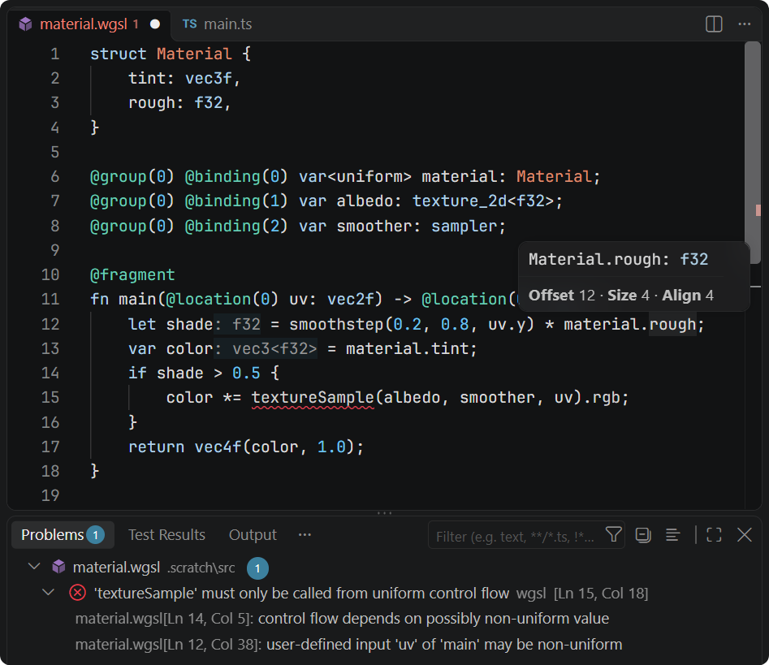

<p align="center"></p>
<br/>
<p align="center">
  <a href="https://marketplace.visualstudio.com/items?itemName=Elringus.wgsl-linter"></a>
  <a href="https://www.npmjs.com/package/wgsl-linter"></a>
  <a href="https://codefactor.io/repository/github/elringus/wgsl-linter/overview/main"></a>
  <a href="https://github.com/elringus/wgsl-linter/actions/workflows/codeql.yml"></a>
</p>
<br/>

# WGSL Linter

Language support for WGSL files and templates embedded in JS/TS: a VS Code extension, the `wgsl-lint` command-line tool and a dependency-free analyzer library. Validation [matches Chrome](cts/README.md) and reports all the errors at once.



## Features

- Diagnostics including const-evaluation, uniformity analysis, memory layout and entry-point IO.
- Hover with types, values, memory layout and spec descriptions of the builtins.
- Completion of names in scope, members, swizzles, builtins, attributes and enumerants, with signature help.
- Inlay hints with the inferred types.
- Go to definition, references, rename, symbols, highlights and folding.
- Formatting that keeps the source's line breaks.
- Semantic highlighting.

All but semantic highlighting also work in JS/TS template literals tagged `wgsl`:

```ts
const shader = wgsl`
    ${common}
    @compute @workgroup_size(${size}) fn main() {}
`;
```

Diagnostics depending on the `${}` substitutions are suppressed. Templates are formatted with the "Format WGSL template" code action.

To declare the structs and functions shared across the shaders, list the `.wgsl` files with them in the `wgsl.prelude` setting, as globs relative to the workspace folder.

Diagnostics cover all the `.wgsl` files of the workspace, open or not. Set `wgsl.lint` to `all` to also cover the templates in all the JS/TS files or to `open` to cover only the open documents.

## Command Line

```bash
wgsl-lint [--tag <name>]... [--prelude <file>] <file or directory>...
```

Reports the diagnostics of the `.wgsl` files and, with `--tag`, of the tagged templates in JS/TS files; exits with 1 on errors.

## Library

```ts
import { Document, hover, lint } from "wgsl-linter";

const diagnostics = lint(source);
const info = hover(new Document(source), offset);
```

Positions are UTF-16 offsets.

## Embedding in VS Code Extensions

```ts
import { register } from "wgsl-linter/vscode";

export function activate(context: vscode.ExtensionContext) {
    register(context, { tags: ["wgsl", "shader"], prelude: engineDeclarations });
}
```

- `tags`: tags of the template literals holding WGSL; `wgsl` by default.
- `prelude`: WGSL declarations available to all the shaders, such as engine-provided structs.
- `lint`: the documents to lint, as in the `wgsl.lint` setting; `files` by default.
- `extensions`, `features`: the enable-extensions and language features the target supports; Chrome's by default.

For highlighting, contribute the `wgsl` language with the configuration and grammars in `syntaxes`, as this repository's `package.json` does.

To format all the templates in a document at once, for example from a command, call `formatTemplates(editor, edit, tags)` within a text editor command.

## Development

- `bun run lint`, `bun run test`, `bun run build`; `bun run vsce` packages the extension.
- `bun run publish` publishes the package to npm and the extension to the VS Code Marketplace.
- `bun run cts [query...]` runs the WebGPU conformance tests against the analyzer.
- `bun scripts/builtins.ts` and `bun scripts/docs.ts` regenerate the builtin tables from Tint and the hover descriptions from the spec.
